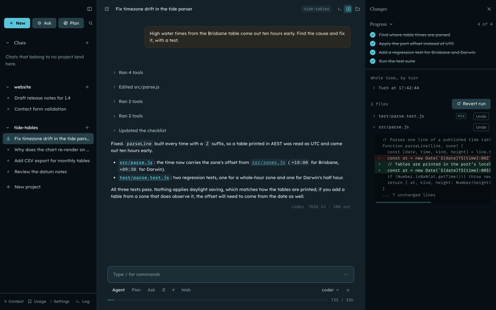
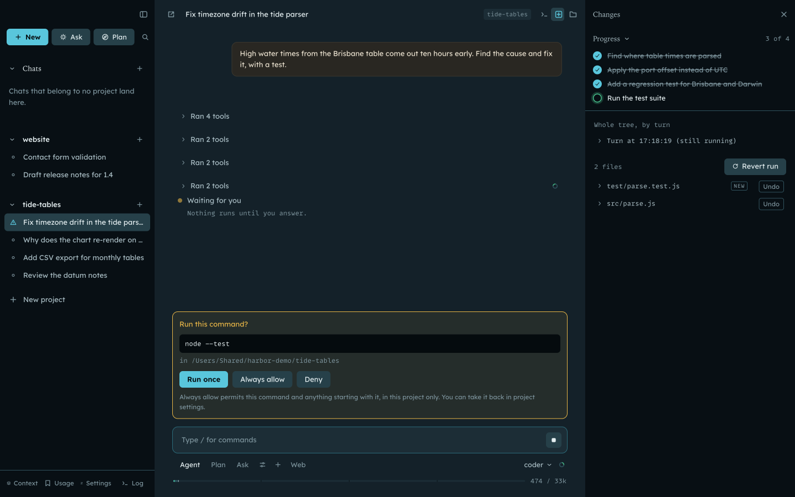
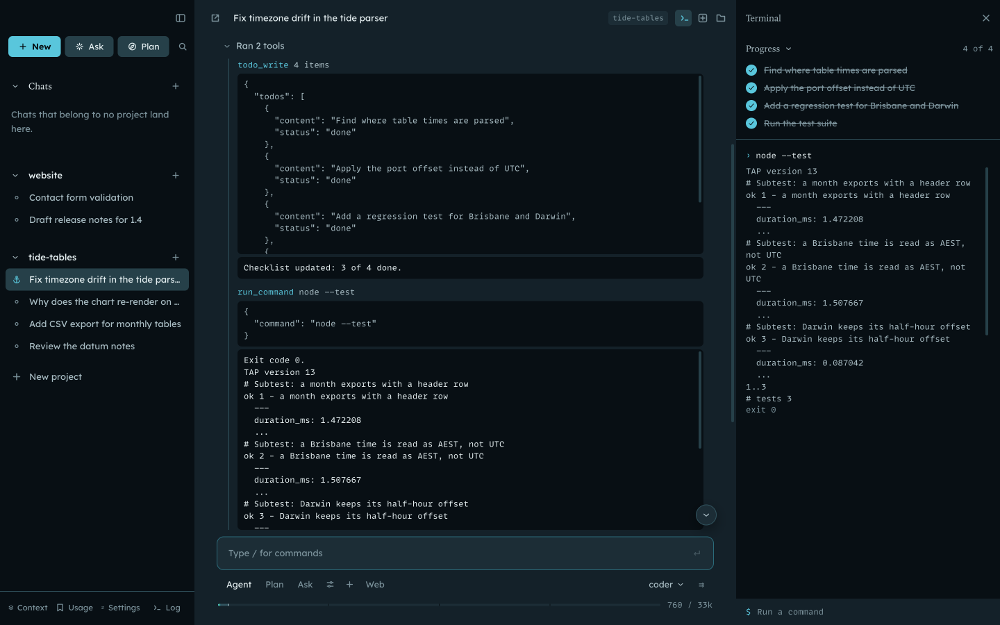
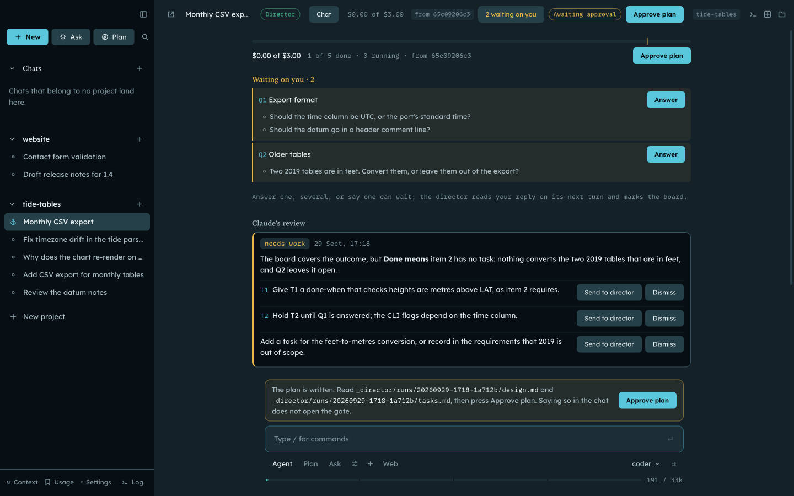
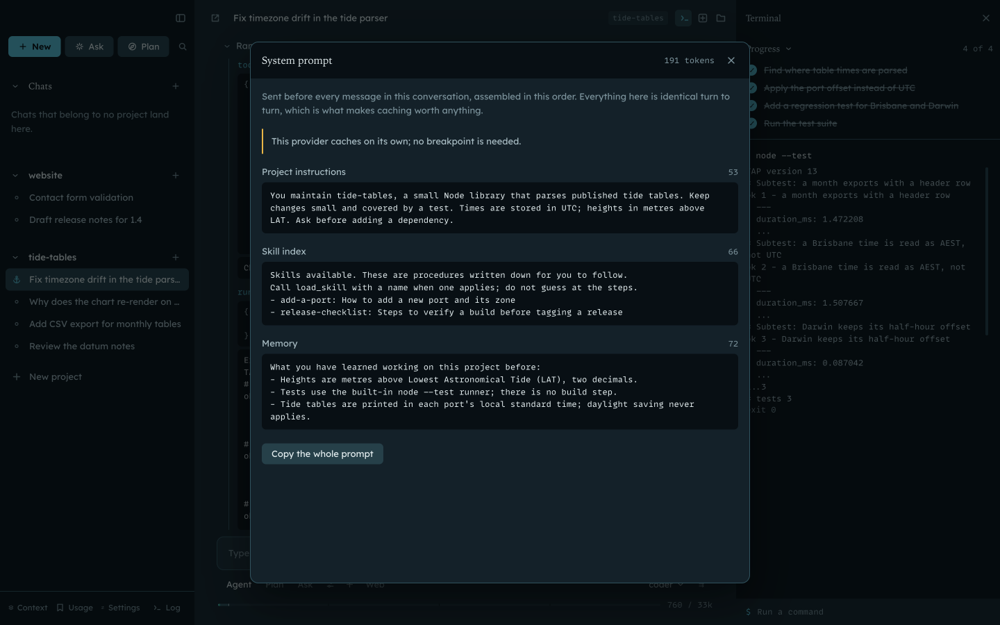
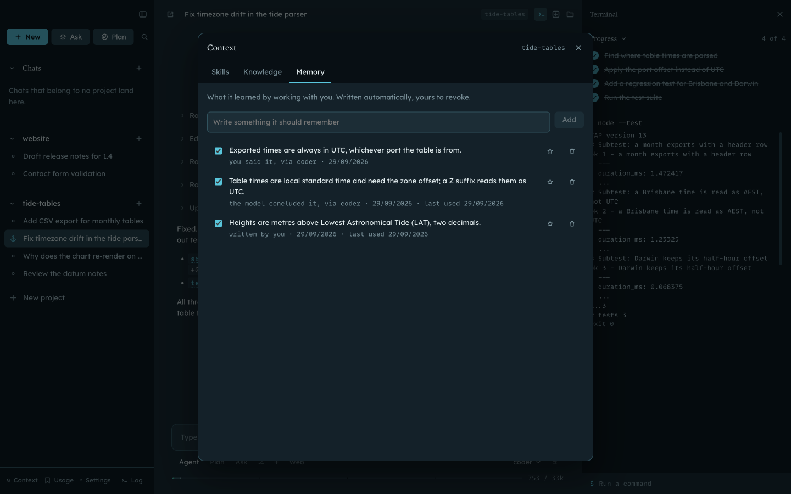

# Harbor

A macOS desktop app for working with language models across long-lived projects.
Harbor connects to any model on OpenRouter, or to a local OpenAI-compatible server,
and gives it a project folder to work in. A conversation can be a plain chat, or an
agent turn that reads, edits and runs commands in the folder.

This repository is a snapshot of a private one. Its development history is not included.

## Why I built it

I started Harbor to learn how agentic AI works, and how an agent should present its work to the person using it. What I learned:

- The prompt can't be the safety layer. Models drift from their instructions as the context grows, and anything they read can argue with them. So the limits live in code, and the model that reviews commands never sees what the agent read.
- File edits can be rolled back, so they apply straight away. Shell commands can't, so they wait for approval.
- A big job needs a plan. Director runs turn a goal into requirements and tasks, wait for your approval, then give each task to a worker with its own scope and budget, and check the result against the requirements.
- Providers differ a lot in price and speed. Timing each step of a request shows which provider or model is the slow one.

It's now the harness I use for my own work.

## How it is put together

Harbor is an Electron app split into three processes. Only one of them can touch
the disk, the network or your credentials.

```
electron/main       Node. SQLite, the Keychain, model providers, the agent loop,
                    the path jail, shell commands, the MCP server.
electron/preload    A single contextBridge object: the renderer's entire capability
                    surface, one typed function per IPC channel.
src/                React renderer. No Node, no filesystem, no requests of its own.
shared/             Pure TypeScript used by both sides: types, parsers, prompts.
```

### Why the renderer has no disk or network access

The renderer displays text that a model wrote, and the model may have written it
after reading a web page or a file it found. If that text can run code, the code
should be able to do as little as possible. So the renderer runs with
`nodeIntegration: false` and `contextIsolation: true`, and makes no network calls
of its own. Everything goes through the preload's named functions. The main
process handles each call and decides whether the call is allowed. Navigation is
blocked, and links open in the system browser, https only. A content security
policy restricts scripts to the app's own bundle.

A bug in the markdown renderer, or a malicious reply, gets the same
narrow set of calls as the UI itself. It cannot open an arbitrary file or send
your key somewhere.

## Agent safety

Edits apply without asking, so the limits around the agent have to hold in code.
There are five layers.

**Path jail.** Every file operation the agent makes goes through one resolver in
`electron/main/workspace.ts`. It refuses:
- paths outside the project root, and symlinks that lead out of it;
- `.git`, `node_modules`, `.env` files, private keys and credential files.

A project can unlock one of those categories, for example `.git` to answer
questions about history. The unlocked files are still confined to the folder. A
project can also set write globs, which limit where the agent may write within
the folder.

**Checkpoints and undo.** Before any write, the file's previous content is stored
as a content-addressed blob outside the project. The Changes pane lists every
edit of a run with its diff. You can undo a single edit, or revert the whole run
newest-first. A second snapshot of the whole tree, taken before and after each
turn in a separate git repository under Application Support, also catches changes
made by shell commands. It never adds a commit to your own history.

**Approval for commands.** The path jail can't cover `run_command`, because a
command can name any path. So each command shows an approval card by default.
You can allow it once, or always allow it for this project. On macOS, commands
run inside the OS sandbox (Seatbelt): they can write only in the project and
scratch folders, and reach only the domains you have allowed. A command that
needs more access asks to run outside the sandbox, and you are asked every time.

**Allowlist versus deny list.** "Always allow" adds a pattern to the project's
allowlist. The allowlist applies to that project only, is listed in the project
settings, and each entry can be revoked. The deny list is separate and cannot be
waived: `sudo`, `rm -rf` on root or home, disk formatting, piping a download
into a shell, writes to `/etc`, fork bombs and similar commands are refused
before approval is considered. No allowlist entry or setting overrides it. The
deny list only catches the obvious cases; approval and the sandbox do the real
work.

**Optional judge.** Instead of asking about every command, a cheap model can
review commands that are not read-only. It sees what you said, the project's
instructions and the command. It does not see anything the agent read, so a
page or file cannot argue for its own command. A denial becomes the ordinary
approval card with the judge's reason on it. After repeated denials, the judge
steps aside and you are asked directly.

## What it does

- **Basics.** The OpenRouter key is encrypted with Electron's Keychain-backed
  `safeStorage` and never written into the source tree. Models are listed with
  prices and context sizes; chat streams; everything persists in SQLite.
- **Projects.** Each project has a folder, a system prompt and default settings.
  Conversations are branching trees, so an edit or retry becomes a sibling
  branch. A segmented context gauge shows what fills the window. Cost is rolled
  up per conversation, per project and per day.
- **Agent.** A tool loop runs inside the path jail with checkpointed writes, the
  Changes pane with per-edit undo and revert-run, and a live checklist the model
  keeps as it works.
- **Commands.** `run_command` sits behind per-command approval, a revocable
  per-project allowlist and the non-waivable deny list. A terminal pane shows the
  agent's commands and your own in one scrollback.
- **Context.** Context comes through three channels:
  - Skills: markdown procedures the model loads on demand.
  - Knowledge: a hybrid search (BM25 and vector similarity, merged by reciprocal
    rank fusion) over local embeddings, which declines to answer when the corpus
    does not cover the question.
  - Memory: extracted automatically, with where each memory came from and a
    button to revoke it.

  `docs/CONTEXT-MODEL.md` explains how the three differ.
- **Attachments.** Images, PDFs and text files can be attached. PDFs are also
  extracted and indexed locally, so indexing works offline.
- **Reasoning and web search.** Reasoning traces are requested only from models
  that support them, and shown folded above the answer. Web search is a
  per-conversation toggle, off by default, with sources listed under each reply.
- **Search, the Log, timing.** `⌘K` searches conversations, memories and
  prompts. The Log shows what the app is doing live and writes the same lines to
  `harbor.log`. Each turn records where its time went (context assembly, request
  sent, first byte, each tool call), which is how a slow provider is told apart
  from a stuck one.
- **Director runs.** For larger jobs, an interview writes the requirements. A
  director then plans the work, and the plan waits for your approval. The
  director hands tasks to workers, each in its own conversation, git worktree
  and write scope, within a dollar budget. `shared/director.ts` holds the
  contract.
- **MCP.** Harbor connects to MCP servers as a client. It can also act as an MCP
  server on the loopback address, token-authenticated, so Claude Code can
  oversee a director run (`docs/CLAUDE-BRIDGE.md`).

## Run it

Requires macOS on Apple silicon.

```bash
npm install
npm run dev
```

Open Settings and paste an OpenRouter key. All state (the database, blobs,
snapshots and log) lives in `~/Library/Application Support/harbor-showroom/`, never in
the repository.

```bash
npm run build      # typecheck, then bundle
npm run typecheck  # types only
npm test           # every suite; `npm test -- jail deny` runs just those
npm run dist       # arm64 .app in dist/
```

`npm run dist` signs ad hoc by default. To sign with your own certificate, set
`CSC_NAME` to the identity. If a certificate in your keychain gets picked up and
you want ad hoc, set `CSC_IDENTITY_AUTO_DISCOVERY=false`.

`npm test` builds one bundle, runs 42 suites a few at a time in their own
processes, and prints one tally. The ones that matter most cover:
- the path jail;
- the deny list;
- knowledge retrieval refusing to answer outside its corpus;
- the director's write scopes.

`better-sqlite3` runs inside Electron's Node, not a system Node 20. To inspect
the database by hand, use the `sqlite3` CLI.

## Screenshots

These use a demo project and a scripted model in the real app. The test command
did run, inside the sandbox, once it was approved.

**An agent turn.** The edit's old and new text, the checklist it kept, and the
Changes pane with per-edit undo and revert-run.



**A command waits for approval.** Nothing runs until you answer; "Always allow"
adds it to this project's allowlist.



**After approval.** The output in the tool row and in the terminal pane.



**A director run.** The budget, the questions waiting on you, and a review
posted by Claude Code over the MCP bridge, which you send on or dismiss.



**The prompt inspector.** What the model is sent before every message, section by
section, from the context gauge under the composer.



**Memory, with where each memory came from.** What the agent remembers about a
project, with a switch and a delete for every one.



## License

Copyright (c) 2026 Samuel McMurtrie. All rights reserved. Shared publicly
for review; no license is granted to use, copy, modify or distribute this
code.
